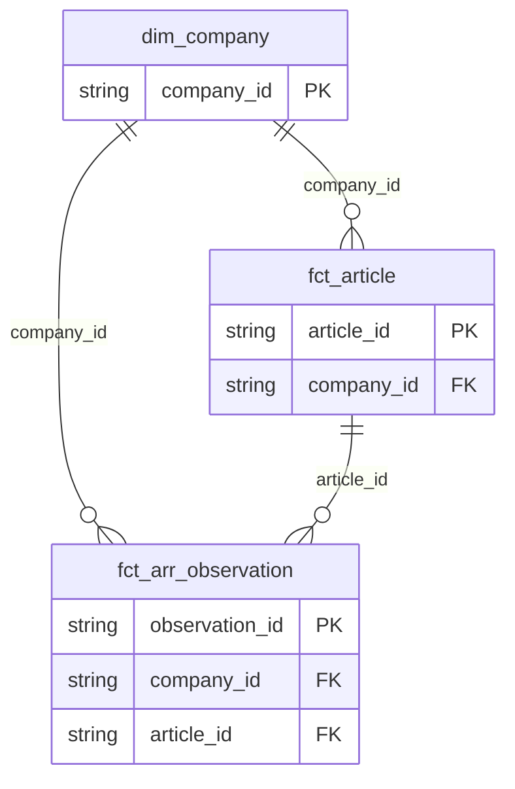

# 🏛️ Data Architecture & Systems Design Guide

This repository contains **4 distinct, independent data engineering projects**. Rather than blending all domains into a single monolithic pipeline, each project showcases a specialized data engineering paradigm with dedicated code, tests, and storage.

---

## 🗺️ Project Portfolio Architecture Map

| Project | Domain & Focus | Directory | Key Architectural Pattern |
| :--- | :--- | :--- | :--- |
| **Project 1** | Tech News & ARR Financials | [`part1_tech_news_lakehouse/`](file:///c:/Users/sivak/OneDrive/Pictures/blank_backup/Projectx/tech-news-arr-warehouse/part1_tech_news_lakehouse) | Medallion Lakehouse (`Bronze` $\rightarrow$ `Silver` $\rightarrow$ `Gold`) + Star Schema |
| **Project 2** | Customer Dimensions | [`part2_slowly_changing_dimensions/`](file:///c:/Users/sivak/OneDrive/Pictures/blank_backup/Projectx/tech-news-arr-warehouse/part2_slowly_changing_dimensions) | Slowly Changing Dimensions (`SCD Type 1`, `Type 2`, `Type 3`) |
| **Project 3** | Event Streaming & CDC | [`part3_realtime_streaming_cdc/`](file:///c:/Users/sivak/OneDrive/Pictures/blank_backup/Projectx/tech-news-arr-warehouse/part3_realtime_streaming_cdc) | Micro-batch Streaming, 48h Watermarking, DLQ, and CDC `MERGE INTO` |
| **Project 4** | Data Quality & Governance | [`part4_data_contracts_lineage/`](file:///c:/Users/sivak/OneDrive/Pictures/blank_backup/Projectx/tech-news-arr-warehouse/part4_data_contracts_lineage) | Programmatic Data Contracts & Column-Level Lineage Catalog |

---

## 1. Project 1: Tech News & ARR Star Schema Lakehouse

### A. Architectural Purpose
Showcases a classic **Batch Medallion Lakehouse** converting unstructured tech news articles and company metadata into an analytics-ready **Dimensional Star Schema** and downstream AI deliverables.

### B. Medallion Data Flow
```
[ Raw CSV / JSON Files ]
  ├─ tech_news.csv (750 articles)
  └─ company_metadata.json (21 seed companies)
          │
          ▼
[ 1. Bronze Layer (bronze.py) ]
  ├─ Ingests raw structured CSV and nested company metadata
  └─ Deduplicates records across natural keys (article_id, title)
          │
          ▼
[ 2. Silver Layer (silver.py) ]
  ├─ Canonicalizes 46 company aliases -> 21 master companies
  ├─ Normalizes 19 messy categories -> 7 standard taxonomies
  └─ Converts multi-currency revenue (EUR, GBP, JPY, ranges) -> USD integers (arr_usd_M)
          │
          ▼
[ 3. Gold Layer (gold.py) ]
  ├─ Materializes 3NF-compliant Star Schema (dim_company, fct_article, fct_arr_observation)
  ├─ Generates pre-computed rollups (agg_company_quarterly_arr, view_company_latest_arr)
  └─ Exports filtered AI/ML cohort (ai_articles_enriched.csv, ARR > $50M)
          │
          ▼
[ Downstream AI & Analytics ]
  ├─ 384-dimensional dense sentence embeddings for semantic search
  └─ DataTalker AI Text-to-SQL Assistant with AST safety guardrails
```

### C. Dimensional Star Schema Model
The Gold analytical warehouse is modeled strictly as a **Star Schema** with `dim_company` at the center and two fact tables capturing article publications and financial revenue observations:

```
                      +---------------------+
                      |     dim_company     |
                      +---------------------+
                      | PK: company_id      |
                      +---------------------+
                                 |
                 +---------------+---------------+
                 |                               |
        (1-to-Many via company_id)      (1-to-Many via company_id)
                 |                               |
                 v                               v
      +---------------------+         +---------------------+
      |     fct_article     |         | fct_arr_observation |
      +---------------------+         +---------------------+
      | PK: article_id      |         | PK: observation_id  |
      | FK: company_id      |         | FK: company_id      |
      +---------------------+         | FK: article_id      |
                                      +---------------------+
```



### D. Table Descriptions & Keys
| Table Name | Role | Primary Key | Foreign Keys | Grain |
| :--- | :--- | :--- | :--- | :--- |
| `dim_company` | Dimension | `company_id` | *None* | 1 row per unique canonical company |
| `fct_article` | Fact | `article_id` | `company_id` | 1 row per published news article |
| `fct_arr_observation` | Fact | `observation_id` | `company_id`, `article_id` | 1 row per financial ARR metric observed |

### E. Financial Math & Normalization Rules
1. **Multi-Currency Normalization to USD**:
   - `EUR` $\times$ 1.09 = USD
   - `GBP` $\times$ 1.28 = USD
   - `JPY` $\times$ 0.0067 = USD
   - Revenue ranges (e.g., `"$10M - $20M"`) resolve to the arithmetic midpoint (`$15,000,000`).
2. **Company Size Categories**:
   - **Small**: $< 10,000$ employees
   - **Medium**: $10,000$ – $30,000$ employees
   - **Large**: $> 30,000$ employees

---

## 2. Project 2: Slowly Changing Dimensions (SCD Types 1, 2, & 3)

### A. Architectural Purpose
Showcases the three industry-standard patterns for handling mutable dimensional attributes over time, implemented purely in functional Python without class bloat or external dependencies.

### B. SCD Architecture & Pattern Comparison
A single source entity (`Customer` tracking loyalty tier upgrades from `Bronze` $\rightarrow$ `Silver` $\rightarrow$ `Gold` $\rightarrow$ `Platinum`) is materialized across all three SCD patterns:

```
        +-----------------------------------------------------------+
        |                 Raw Customer Source Feed                  |
        |  (Customer Profile + Spend-Triggered Loyalty Progression) |
        +-----------------------------------------------------------+
                                      |
          +---------------------------+---------------------------+
          |                           |                           |
          v                           v                           v
+-------------------+       +-------------------+       +-------------------+
| dim_customer_scd1 |       | dim_customer_scd2 |       | dim_customer_scd3 |
+-------------------+       +-------------------+       +-------------------+
| PK: customer_id   |       | PK: customer_sk   |       | PK: customer_id   |
|     loyalty_tier  |       |     customer_id   |       |     curr_loyalty  |
|     credit_limit  |       |     loyalty_tier  |       |     prev_loyalty  |
|     last_updated  |       |     effective_from|       |     curr_credit   |
+-------------------+       |     effective_to  |       |     prev_credit   |
 (In-Place Overwrite)       |     is_current    |       |     change_date   |
 (Zero History)             +-------------------+       +-------------------+
                             (Full Audit History)        (Current vs Prior)
```

### C. SCD Design Matrix
| Pattern | Table | Surrogate Key | Business Key | History Preserved | Ideal Use Case |
| :--- | :--- | :--- | :--- | :--- | :--- |
| **SCD Type 1** | `dim_customer_scd1` | *None* | `customer_id` | **No** (overwritten) | Typos, phone numbers, contact corrections |
| **SCD Type 2** | `dim_customer_scd2` | `customer_sk` | `customer_id` | **Full** (new row per change) | Financial audits, regulatory tracking, point-in-time joins |
| **SCD Type 3** | `dim_customer_scd3` | *None* | `customer_id` | **1 Prior State** (columnar) | Year-over-year sales territory or quota comparisons |

### D. SCD Type 2 Audit Mechanics
In `dim_customer_scd2`, each status update expires the prior active row and inserts a new active row:

| `customer_sk` | `customer_id` | `loyalty_tier` | `effective_start_date` | `effective_end_date` | `is_current_flag` |
| :--- | :--- | :--- | :--- | :--- | :---: |
| `CUST_SK_0007` | `BERGS` | **Silver** | 1996-01-01 | 1997-06-30 | `False` |
| `CUST_SK_0008` | `BERGS` | **Gold** | 1997-07-01 | 1998-03-31 | `False` |
| `CUST_SK_0009` | `BERGS` | **Platinum** | 1998-04-01 | **9999-12-31** | **`True`** |

* **Point-in-Time Joins**:
  ```sql
  SELECT o.order_id, c.loyalty_tier
  FROM fct_orders o
  JOIN dim_customer_scd2 c
    ON o.customer_id = c.customer_id
   AND o.order_date BETWEEN c.effective_start_date AND c.effective_end_date;
  ```
* **Current Active Snapshot**:
  ```sql
  SELECT * FROM dim_customer_scd2 WHERE is_current_flag = TRUE;
  ```

---

## 3. Project 3: Real-Time Streaming & CDC Reconciliation Engine

### A. Architectural Purpose
Demonstrates an enterprise **Micro-Batch Streaming Engine** handling unordered arrivals, corrupted payloads, late event watermarks, and atomic **Change Data Capture (CDC)** reconciliation into Gold tables.

### B. Streaming Pipeline Architecture
```
[ Stream Landing: data/stream_landing/*.jsonl ]
  ├─ High-frequency JSON micro-batches
  └─ Includes op_code: 'I' (Insert), 'U' (Update), 'D' (Delete)
          │
          ▼
[ 1. Payload Schema Gatekeeper ]
  ├─ Validates presence of mandatory keys (event_id, timestamp, op_code)
  └─ Invalid format / non-numeric ARR -> Routes to Dead-Letter Queue (DLQ)
          │
          ▼
[ 2. Event-Time Watermarking (48-Hour Cutoff) ]
  ├─ Evaluates event_timestamp against watermark cutoff
  └─ Late arrivals (> 48h old) are dropped to preserve state stability
          │
          ▼
[ 3. Atomic MERGE INTO Reconciliation ]
  ├─ 'I' (Insert): Appends new articles & observations
  ├─ 'U' (Update): Updates revenue and timestamps in-place
  └─ 'D' (Delete): Retracts invalidated records from Gold tables
          │
          ▼
[ Target Analytical Warehouse ]
  └─ Synchronized Gold Tables (dim_company, fct_article, fct_arr_observation)
```

### C. Resilience Components
1. **Dead-Letter Queue (`DLQ`)**:
   - Quarantines malformed payloads directly into `data/dead_letter_queue/`.
   - Attaches quarantine timestamp, error category, and original payload for re-processing.
2. **48-Hour Watermarking**:
   - Maintains real-time state boundaries. Events older than $T_{\text{max}} - 48\text{h}$ are discarded.
3. **Atomic `MERGE INTO` Logic**:
   - Ensures exactly-once idempotent updates across concurrent micro-batches.

---

## 4. Project 4: Enterprise Data Contracts & Lineage Governance

### A. Architectural Purpose
Provides automated **Data Quality Contracts** and an automated **Column-Level Lineage Governance Catalog** to guarantee data reliability and pipeline auditability.

### B. Data Contracts Validation Engine
Programmatically enforces structural constraints before downstream consumption:

```
[ Warehouse Deliverables ]
          │
          ▼
+-----------------------------------------------------------+
|               DataContractValidator Engine                |
|  (data_contracts.py)                                      |
+-----------------------------------------------------------+
  ├─ PRIMARY_KEY   -> Uniqueness & non-null key check
  ├─ NOT_NULL      -> Critical business fields cannot be null
  ├─ CHECK_RANGE   -> Numeric bounds (e.g., arr_usd_M > 0)
  ├─ ENUM_TAXONOMY -> Strict categorical values (e.g., loyalty_tier)
  └─ FOREIGN_KEY   -> Zero orphan records across dimensions & facts
          │
          ▼
[ Output: data/data_quality_report.json ] (100% Pass Scorecard)
```

### C. Automated Data Lineage Catalog
Extracts end-to-end transformation provenance from source files to analytical models:

```
[ Source Files ]  ──> [ Transformations ] ──> [ Gold Models ]
  tech_news.csv          clean_articles()        dim_company
  company_metadata.json  parse_revenue()         fct_article
  customers.csv          apply_scd_logic()       fct_arr_observation
                                                 dim_customer_scd1/2/3
          │
          ▼
[ Output: data/metadata_catalog.json ]
  ├─ Table-level schemas & record counts
  ├─ Column-level data types & business descriptions
  └─ Complete upstream and downstream dependency graph
```

---

## 5. Master Platform Execution Map

All 4 projects can be executed together via the root orchestrator or independently inside their own directories:

```bash
# Option 1: Execute all 4 projects sequentially with full streaming & lineage
python pipeline.py --streaming --lineage

# Option 2: Execute Project 1 standalone (Medallion Star Schema)
python part1_tech_news_lakehouse/pipeline.py

# Option 3: Launch Project 1 AI Text-to-SQL Assistant
python part1_tech_news_lakehouse/text_to_sql.py

# Option 4: Execute Project 2 standalone (SCD 1, 2, and 3)
python part2_slowly_changing_dimensions/scd_pipeline.py

# Option 5: Execute Project 3 standalone (Streaming & CDC)
python part3_realtime_streaming_cdc/streaming_cdc.py

# Option 6: Execute Project 4 standalone (Contracts & Lineage)
python part4_data_contracts_lineage/data_contracts.py
```
