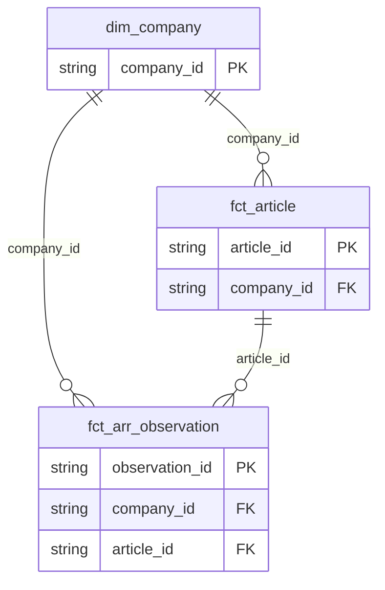

# 🏛️ Multi-Domain Data Architecture & Dimensional Modeling Guide

## 1. Enterprise Architecture Overview (Multi-Domain Medallion & Streaming Lakehouse)
This platform implements an enterprise-grade **Multi-Domain Medallion Lakehouse** (`Bronze` $\rightarrow$ `Silver` $\rightarrow$ `Gold`) combined with a **Real-Time Streaming & CDC Engine** (Event-Time Watermarking, Dead-Letter Queue `DLQ`, and atomic `MERGE INTO` reconciliation).

```
[ MULTI-SOURCE INGESTION ]
  ├─ Domain A (Batch):  tech_news.csv (750 articles), company_metadata.json (21 seed companies)
  ├─ Domain B (Batch):  E-Commerce relational tables (orders, order_details, products, customers, categories)
  └─ Domain C (Stream): Real-time JSONL event stream (data/stream_landing/)
          │
          ▼
[ 1. BRONZE LAYER: Raw Ingestion & Schema Profiling ]
  - Zero-mutation ingestion preserving full source provenance and raw line-level audit trails.
  - Structural schema validation and automated null/type profiling.
          │
          ▼
[ 2. SILVER LAYER: Cleansing, Normalization & Feature Engineering ]
  - Domain A: Canonicalize company aliases (AWS -> Amazon Web Services), standardize 19 messy categories to 7, parse multi-currency FX (EUR, GBP, JPY, midpoint ranges) to normalized USD integers.
  - Domain B: Parse ISO order dates, compute fulfillment duration (`fulfillment_days`), calculate gross, line discounts, and net financial totals.
  - Domain C: Real-time schema validation with Dead-Letter Queue (`DLQ`) routing and Event-Time Watermarking (late-event cutoff).
          │
          ▼
[ 3. GOLD LAYER: Multi-Domain Star Schema & Analytical Models ]
  - Domain A (Tech News & ARR):
    * dim_company (Master company dimension, N = 26)
    * fct_article (750 news articles with standardized dates & categories)
    * fct_arr_observation (558 point-in-time revenue observations in USD)
    * agg_company_quarterly_arr (315 quarterly financial rollups)
    * view_company_latest_arr (26 company point-in-time latest ARR snapshots)
    * ai_articles_enriched.csv (124 filtered AI/ML records with ARR > $50M)
  - Domain B (E-Commerce Omnichannel Retail):
    * dim_customer_scd2 (Slowly Changing Dimension Type 2 with historical loyalty tier versioning, N = 175)
    * dim_product (77 SKUs with category denormalization, margin & stock health flags)
    * dim_date (732 calendar date records with Year, Quarter, Month, Weekend flags)
    * fct_orders (830 orders with fulfillment duration and net financial totals)
    * fct_order_items (2,155 line items with gross, discount rate, and net totals)
    * agg_customer_rfm (89 customer 360 RFM segmentation profiles)
```

---

## 2. Dimensional Data Models

### A. Domain A: Tech News & ARR Lakehouse Model

```
                      +---------------------+
                      |     dim_company     |
                      +---------------------+
                      | PK: company_id      |
                      +---------------------+
                                 |
                 +---------------+---------------+
                 |                               |
        (1-to-Many via company_id)      (1-to-Many via company_id)
                 |                               |
                 v                               v
      +---------------------+         +---------------------+
      |     fct_article     |         | fct_arr_observation |
      +---------------------+         +---------------------+
      | PK: article_id      |         | PK: observation_id  |
      | FK: company_id      |         | FK: company_id      |
      +---------------------+         | FK: article_id      |
                                      +---------------------+
```



---

### B. Domain B: Slowly Changing Dimensions (SCD Types 1, 2, & 3)

Domain B focuses strictly on **Slowly Changing Dimensions (SCD)**: how to store and track customer attribute changes (such as loyalty tier upgrades from Bronze -> Silver -> Gold -> Platinum) over time.

```
       +-----------------------------------------------------------+
       |                  Raw Customer Data Source                 |
       |  (Customer Profile + Spend-Triggered Loyalty Progression) |
       +-----------------------------------------------------------+
                                     |
         +---------------------------+---------------------------+
         |                           |                           |
         v                           v                           v
+------------------+       +-------------------+       +-------------------+
|  dim_cust_scd1   |       |   dim_cust_scd2   |       |   dim_cust_scd3   |
+------------------+       +-------------------+       +-------------------+
| PK customer_id   |       | PK customer_sk    |       | PK customer_id    |
|    company_name  |       |    customer_id    |       |    company_name   |
|    loyalty_tier  |       |    loyalty_tier   |       |    curr_loyalty   |
|    credit_limit  |       |    credit_limit   |       |    prev_loyalty   |
|    last_updated  |       |    start_date     |       |    curr_credit    |
+------------------+       |    end_date       |       |    prev_credit    |
 (In-Place Overwrite)      |    is_current     |       |    change_date    |
 (Zero History)            +-------------------+       +-------------------+
                            (Full Versioning)           (Current vs Prev)
```

#### SCD Pattern Comparison on the Same Customer:

| Pattern | Table | Key Columns | Best Used For |
| :--- | :--- | :--- | :--- |
| **SCD Type 1** | `dim_customer_scd1` | `customer_id`, `loyalty_tier`, `last_updated_at` | Correcting errors, typos (no history needed) |
| **SCD Type 2** | `dim_customer_scd2` | `customer_sk`, `effective_start_date`, `effective_end_date`, `is_current_flag` | Historical audit compliance, point-in-time financial joins |
| **SCD Type 3** | `dim_customer_scd3` | `current_loyalty_tier`, `previous_loyalty_tier`, `tier_change_date` | Fast before-and-after marketing comparisons |

---

## 3. Slowly Changing Dimension Type 2 (SCD 2) Mechanics

In `dim_customer_scd2`, customer records track historical loyalty tier progressions and credit limit adjustments over time without losing historical purchase alignment:

| `customer_sk` | `customer_id` | `company_name` | `loyalty_tier` | `credit_limit_usd` | `effective_start_date` | `effective_end_date` | `is_current_flag` |
| :--- | :--- | :--- | :--- | :--- | :--- | :--- | :---: |
| `CUST_SK_0007` | `BERGS` | Berglunds snabbköp | **Silver** | $10,000 | 1996-01-01 | 1997-06-30 | `False` |
| `CUST_SK_0008` | `BERGS` | Berglunds snabbköp | **Gold** | $25,000 | 1997-07-01 | 1998-03-31 | `False` |
| `CUST_SK_0009` | `BERGS` | Berglunds snabbköp | **Platinum** | $50,000 | 1998-04-01 | **9999-12-31** | **`True`** |

* **Historical Point-in-Time Queries**: Joining `fct_orders.order_date BETWEEN dim_customer_scd2.effective_start_date AND dim_customer_scd2.effective_end_date` recovers the exact customer tier at the moment the purchase took place.
* **Current State Queries**: Filtering `WHERE is_current_flag = True` yields the active customer profile.

---

## 4. Real-Time Streaming & CDC Engine Architecture

The streaming CDC module (`part3_realtime_streaming_cdc/streaming_cdc.py`) processes high-frequency JSON micro-batches from `data/stream_landing/`:

1. **Payload Schema Validation**:
   - Validates mandatory fields (`event_id`, `event_timestamp`, `op_code`, `article_id`, `company_name`).
   - Ensures valid operation codes: `'I'` (Insert), `'U'` (Update), `'D'` (Delete).
2. **Dead-Letter Queue (DLQ) Quarantining**:
   - Any corrupt record (missing primary IDs, non-numeric ARR strings) is diverted to `data/dead_letter_queue/` with execution failure metadata and UTC timestamp.
3. **Event-Time Watermarking**:
   - Configurable watermark delay window (default = 48 hours).
   - Events arriving with `event_timestamp < (current_time - watermark_window)` are dropped or logged as late arrivals to protect state stability.
4. **Atomic `MERGE INTO` CDC Reconciliation**:
   - Reconciles live insertions, financial revisions, and retractions directly against Gold star-schema tables (`fct_arr_observation`, `fct_article`, `dim_company`, `view_company_latest_arr`).

---

## 5. Core Business & Metric Calculation Rules

1. **Multi-Currency Normalization to USD**:
   - `EUR` $\times$ 1.09 = USD
   - `GBP` $\times$ 1.28 = USD
   - `JPY` $\times$ 0.0067 = USD
   - Revenue ranges (e.g., `"$10M - $20M"`) take the arithmetic midpoint (`$15,000,000`).
2. **Company Size Thresholds**:
   - **Small**: $< 10,000$ employees
   - **Medium**: $10,000$ – $30,000$ employees
   - **Large**: $> 30,000$ employees
