# 📰 Tech News & Multi-Domain Analytical Lakehouse Platform

[](https://github.com/chanakyachandu/tech-news-arr-warehouse/actions/workflows/ci.yml)
[](https://www.python.org/)
[](DATA_ARCHITECTURE.md)
[](DATA_ARCHITECTURE.md)
[](tests/)
[](part1_tech_news_lakehouse/notebooks/04_sql_queries.ipynb)

An enterprise-grade data platform structured into **4 distinct, independent projects**:
1. **Project 1 (Tech News & ARR Lakehouse)**: Medallion batch architecture (`Bronze` $\rightarrow$ `Silver` $\rightarrow$ `Gold`), Star Schema, and Natural Language to SQL Assistant ("DataTalker AI").
2. **Project 2 (Slowly Changing Dimensions)**: Functional implementations of SCD Type 1, Type 2 (audit history), and Type 3 (previous state).
3. **Project 3 (Real-Time Streaming & CDC Engine)**: Event-time watermarking (48h cutoff), DLQ error quarantine, and atomic `MERGE INTO` reconciliation.
4. **Project 4 (Data Contracts & Lineage Governance)**: Automated programmatic contract validation and column-level metadata lineage catalog.

```mermaid
flowchart TD
    subgraph P1["📰 Project 1: Tech News & ARR Lakehouse"]
        P1_RAW["Raw Articles & Company Metadata"]
        P1_MED["Medallion: Bronze ➔ Silver ➔ Gold"]
        P1_STAR["Star Schema: dim_company, fct_article, fct_arr_observation"]
        P1_AI["Downstream: Vector Semantic Search & DataTalker AI"]
        P1_RAW --> P1_MED --> P1_STAR --> P1_AI
    end

    subgraph P2["🔄 Project 2: Slowly Changing Dimensions (SCD)"]
        P2_RAW["Customer Progression Feed"]
        P2_S1["SCD Type 1: In-Place Overwrite"]
        P2_S2["SCD Type 2: Historical Versioning (customer_sk)"]
        P2_S3["SCD Type 3: Prior State (previous_loyalty)"]
        P2_RAW --> P2_S1
        P2_RAW --> P2_S2
        P2_RAW --> P2_S3
    end

    subgraph P3["⚡ Project 3: Real-Time Streaming & CDC"]
        P3_IN["JSONL Micro-Batches"]
        P3_VAL["Schema & 48h Watermark Filter"]
        P3_DLQ["Dead-Letter Queue (DLQ)"]
        P3_CDC["Atomic MERGE INTO (I / U / D)"]
        P3_IN --> P3_VAL
        P3_VAL -->|Corrupted / Late| P3_DLQ
        P3_VAL -->|Valid & On-Time| P3_CDC
    end

    subgraph P4["🛡️ Project 4: Data Contracts & Lineage Governance"]
        P4_RUN["Automated Quality Validator"]
        P4_REP["data_quality_report.json (100% Pass)"]
        P4_CAT["metadata_catalog.json (Column-Level Provenance)"]
        P4_RUN --> P4_REP
        P4_RUN --> P4_CAT
    end
```



---

## 📁 Repository Structure

```
tech-news-arr-warehouse/
├── part1_tech_news_lakehouse/         # 📰 Project 1: Batch Star Schema Lakehouse
│   ├── bronze.py                      # Raw ingestion & schema boundary gatekeeping
│   ├── silver.py                      # FX currency normalization & entity resolution
│   ├── gold.py                        # Dimensional star schema (dim_company, fct_article, fct_arr)
│   ├── pipeline.py                    # Dedicated Part 1 pipeline runner
│   ├── notebooks/                     # Interactive demonstration notebooks (01 to 05)
│   ├── advanced_semantic_search/      # 🤖 Vector Embeddings & Hybrid Search
│   ├── ai_text_to_sql/                # 💬 DataTalker AI Text-to-SQL Assistant
│   └── text_to_sql.py                 # 💬 Project 1 Interactive Text-to-SQL CLI Launcher
│
├── part2_slowly_changing_dimensions/  # 🔄 Project 2: Slowly Changing Dimensions (SCD 1, 2, 3)
│   ├── scd_pipeline.py                # Pure functional Python SCD engine (0 classes)
│   └── scd_demonstration.ipynb        # SCD comparison & DuckDB point-in-time SQL demo
│
├── part3_realtime_streaming_cdc/      # ⚡ Project 3: Real-Time Streaming & CDC Reconciliation
│   ├── streaming_cdc.py               # Micro-batches, 48h watermarking, DLQ & atomic MERGE
│   └── realtime_cdc_streaming.ipynb   # Interactive streaming event demo
│
├── part4_data_contracts_lineage/      # 🛡️ Project 4: Enterprise Quality & Governance
│   ├── data_contracts.py              # Programmatic constraints validator (PK, NOT NULL, Range, FK)
│   └── lineage.py                     # Table & column-level provenance catalog engine
│
├── tests/                             # 🧪 Automated Test Suite (pytest - 28 Tests)
│   ├── test_part1_lakehouse.py        # Part 1 Star Schema & transformations (12 Tests)
│   ├── test_part2_scd.py              # Part 2 SCD surrogate keys & date ranges (6 Tests)
│   ├── test_part3_streaming.py        # Part 3 Streaming, watermark & DLQ (5 Tests)
│   └── test_part4_governance.py       # Part 4 Data contracts & lineage catalog (5 Tests)
│
├── pipeline.py                        # 🚀 Multi-domain master CLI orchestrator
├── DATA_ARCHITECTURE.md               # Dimensional star schema specifications & governance
├── README.md                          # Master documentation and portfolio guide
├── Task.txt                           # Project specification document
├── requirements.txt                   # Pinned Python dependencies
├── .gitignore                         # Git exclusion rules for clean commits
│
└── data/                              # 💾 Data Storage
    ├── raw/                           # Raw datasets
    │   ├── tech_news.csv              # Domain A: 750 raw tech articles
    │   ├── company_metadata.json      # Domain A: 21 seed companies metadata
    │   └── ecommerce/                 # 🛍️ Domain B: 5 relational E-Commerce CSVs
    ├── processed/                     # Cleaned Silver datasets (Articles & E-Commerce)
    ├── stream_landing/                # ⚡ Real-time JSON micro-batch landing zone
    ├── dead_letter_queue/             # ⚡ Quarantined corrupt event records (DLQ)
    └── warehouse/                     # Gold relational warehouse tables
        ├── dim_company.csv            # Company dimension (N = 26)
        ├── fct_article.csv            # Article fact table (N = 750)
        ├── fct_arr_observation.csv    # ARR observations (N = 558)
        └── ecommerce/                 # 🛍️ Project 2 SCD Dimension Tables
            ├── dim_customer_scd1.csv  # SCD Type 1 in-place overwrite (N = 91)
            ├── dim_customer_scd2.csv  # SCD Type 2 full history with surrogate keys (N = 175)
            └── dim_customer_scd3.csv  # SCD Type 3 previous-tier tracking (N = 91)
```

---

## 🌊 End-to-End Pipeline Flow & Data Lifecycle

The platform executes across **4 distinct, specialized data engineering projects**:

| Project Domain | Directory & Code | Input Sources | Primary Responsibilities |
| :--- | :--- | :--- | :--- |
| **Project 1: Tech News Lakehouse** | [`part1_tech_news_lakehouse/`](part1_tech_news_lakehouse) | `data/raw/*.csv` | Medallion lakehouse (Bronze, Silver, Gold), FX normalization, Star Schema, AI text-to-SQL. |
| **Project 2: Slowly Changing Dimensions** | [`part2_slowly_changing_dimensions/`](part2_slowly_changing_dimensions) | `data/raw/ecommerce/` | Procedural implementation of SCD Type 1, Type 2 (history tracking), and Type 3 (prior state). |
| **Project 3: Streaming & CDC** | [`part3_realtime_streaming_cdc/`](part3_realtime_streaming_cdc) | `data/stream_landing/` | Event-time watermarking (48h cutoff), DLQ error quarantine, atomic `MERGE INTO` reconciliation. |
| **Project 4: Contracts & Lineage** | [`part4_data_contracts_lineage/`](part4_data_contracts_lineage) | Gold Warehouse Tables | Programmatic data quality contract enforcement and column-level lineage governance catalog. |


### 1. Project 1: Tech News Lakehouse & Star Schema
* **Code**: [`part1_tech_news_lakehouse/`](part1_tech_news_lakehouse) (`bronze.py`, `silver.py`, `gold.py`, `text_to_sql.py`) |
  **Notebooks**: `part1_tech_news_lakehouse/notebooks/` (01 to 05)
* **Inputs**: Raw CSVs in `data/raw/*.csv` (`tech_news.csv`, `company_metadata.json`).
* **Process**:
  * **Bronze**: Ingests raw structured CSVs and flattens metadata without schema mutation.
  * **Silver**: Resolves aliases to canonical entities, normalizes currencies to USD (`arr_usd_M`).
  * **Gold**: Models 1NF-3NF Star Schema (`dim_company`, `fct_article`, `fct_arr_observation`).

### 2. Project 2: Slowly Changing Dimensions (SCD 1, 2, 3)
* **Code**: [`part2_slowly_changing_dimensions/scd_pipeline.py`](part2_slowly_changing_dimensions/scd_pipeline.py) |
  **Notebook**: [`part2_slowly_changing_dimensions/scd_demonstration.ipynb`](part2_slowly_changing_dimensions/scd_demonstration.ipynb)
* **Process**:
  * **SCD Type 1**: In-place overwrites for non-historical corrections.
  * **SCD Type 2**: Comprehensive audit trail with `is_current_flag`, `effective_start_date`, and `effective_end_date`.
  * **SCD Type 3**: Preserves immediate previous value in dedicated `previous_*` attribute columns.

### 3. Project 3: Real-Time Streaming & CDC Layer
* **Code**: [`part3_realtime_streaming_cdc/streaming_cdc.py`](part3_realtime_streaming_cdc/streaming_cdc.py) |
  **Notebook**: [`part3_realtime_streaming_cdc/realtime_cdc_streaming.ipynb`](part3_realtime_streaming_cdc/realtime_cdc_streaming.ipynb)
* **Process**:
  * **Event-Time Watermarking**: Evaluates incoming events against a 48-hour watermark window, discarding late arrivals.
  * **Dead-Letter Queue (DLQ)**: Quarantines corrupted or malformed payloads into `data/dead_letter_queue/`.
  * **Atomic `MERGE INTO` CDC Reconciliation**: Reconciles live `INSERT`, `UPDATE`, and `DELETE` events into Gold tables.

### 4. Project 4: Enterprise Quality Contracts & Lineage Governance
* **Code**: [`part4_data_contracts_lineage/`](part4_data_contracts_lineage) (`data_contracts.py`, `lineage.py`)
* **Process**:
  * Programmatic assertion of primary keys, nullability, range boundaries, and referential integrity.
  * Dynamic column-level and table-level lineage catalog with transformation provenance export.

### 5. Multi-Project Pipeline Orchestration
* **Code**: [`pipeline.py`](pipeline.py)
* **Process**:
  * Executes all 4 projects end-to-end sequentially via `python pipeline.py --streaming` with stage latency telemetry.

### 6. Automated Quality Testing Layer
* **Code**: [`tests/`](tests/) | **Runner**: `pytest`
* **Coverage**: **28 passing tests** asserting FX math, star schema grains, SCD 1/2/3 logic, watermarking cutoff, data contracts, and lineage generation.

### 7. Analytical SQL Exploration Layer
* **Notebooks**: [`part1_tech_news_lakehouse/notebooks/04_sql_queries.ipynb`](part1_tech_news_lakehouse/notebooks/04_sql_queries.ipynb)
* **Process**:
  * Zero-copy in-memory DuckDB queries for window rankings, quarter-over-quarter ARR growth, and category aggregations.

### 8. Downstream AI & Semantic Search Layer
* **Code**: [`part1_tech_news_lakehouse/advanced_semantic_search/`](part1_tech_news_lakehouse/advanced_semantic_search) |
  **Notebook**: [`part1_tech_news_lakehouse/advanced_semantic_search/semantic_search.ipynb`](part1_tech_news_lakehouse/advanced_semantic_search/semantic_search.ipynb)
* **Process**:
  * 384-dimensional dense sentence embeddings for cosine similarity search and hybrid SQL metadata filtering.

### 9. Natural Language to SQL Assistant Layer ("DataTalker AI")
* **Code**: [`part1_tech_news_lakehouse/ai_text_to_sql/`](part1_tech_news_lakehouse/ai_text_to_sql) |
  **Launcher**: [`part1_tech_news_lakehouse/text_to_sql.py`](part1_tech_news_lakehouse/text_to_sql.py) |
  **Notebook**: [`part1_tech_news_lakehouse/notebooks/05_ai_text_to_sql.ipynb`](part1_tech_news_lakehouse/notebooks/05_ai_text_to_sql.ipynb)
* **Components**:
  * **Schema Provider**: Dynamically inspects tables, types, foreign keys, and sample rows.
  * **AST Safety Guard**: Blocks 16 destructive keywords and injects row limits.
  * **AI SQL Generator & Self-Correction**: Translates English questions into DuckDB SQL with auto-retries on error.
  * **Executive Explainer**: Synthesizes tabular results into 2-sentence plain English executive briefs.

---

## 🚀 1. System Requirements & Installation

### Requirements
* **Python**: 3.9+ (Tested on Python 3.11, 3.12 & 3.13)
* **OS**: Windows, macOS, Linux
* **Memory**: Minimum 4GB RAM

### Installation & Environment Setup
Clone the repository, configure environment variables, and install dependencies:
```bash
git clone https://github.com/chanakyachandu/tech-news-arr-warehouse.git
cd tech-news-arr-warehouse

# Copy the sample environment file and add your Gemini API Key
cp .env.example .env

# Virtual environment setup
python -m venv .venv

# Windows:
.venv\Scripts\activate

# macOS / Linux:
source .venv/bin/activate

pip install -r requirements.txt
```

---

## ⚡ 2. How to Run the Pipeline

### Option A: Run the End-to-End Master Pipeline (All 4 Projects)
Execute the multi-project orchestrator across all 4 data engineering domains:
```bash
python pipeline.py
```

### Option B: Run Project 1 Medallion Lakehouse Stages
Each medallion stage can also be executed independently:
```bash
python -m part1_tech_news_lakehouse.bronze   # Run Bronze raw ingestion
python -m part1_tech_news_lakehouse.silver   # Run Silver cleaning & normalization
python -m part1_tech_news_lakehouse.gold     # Run Gold dimensional modeling & exports
```

### Option C: Launch the Interactive AI Text-to-SQL Assistant (Project 1)
Chat directly with the modeled warehouse dataset using plain English:
```bash
python part1_tech_news_lakehouse/text_to_sql.py
```

---

## 🧪 3. Running Automated Tests & CI/CD

A comprehensive `pytest` test suite validates currency parsing, range midpoints, category taxonomies, star schema grains, and referential integrity:

```bash
pytest tests/ -v
```

GitHub Actions automatically runs this test suite across **Python 3.10, 3.11, and 3.12** on every pull request and push to `main`.

---

## 💡 4. Engineering Trade-offs & Production Gotchas

Real-world data pipelines must be resilient to unexpected schema mutations and poison records. Here is how critical challenges were resolved:

| Challenge / "What Broke" | Root Cause | Engineering Solution |
| :--- | :--- | :--- |
| **Malformed Ingestion Payloads** | Ingesting raw JSONL with corrupted types or missing required keys crashed batch runs. | **Dead-Letter Queue (DLQ)** isolation: Unprocessable records are quarantined into `data/dead_letter_queue/` with timestamped diagnostics without stopping the pipeline. |
| **Out-of-Order CDC Events** | Updates arriving before original inserts caused phantom duplicates or missed states. | **Event-Time Watermarking & Idempotent `MERGE INTO`**: Reconciles operations (`I`, `U`, `D`) using surrogate primary key lookups and event timestamps. |
| **Currency Inconsistencies (FX)** | Multi-currency ARR figures (EUR, GBP, USD, INR) skewed aggregate metric calculations. | **Standardized Silver Normalization**: Automated FX rate dictionary lookup with fallback logging to convert all revenue figures to unified USD. |
| **SQL Injection in AI Queries** | LLM-generated SQL queries could execute destructive DDL/DML statements (`DROP`, `DELETE`). | **AST-Based SQL Safety Guard**: Read-only validation layer that parses the abstract syntax tree, blocks 16 destructive keywords, and injects safe row limit clamps (`LIMIT 100`). |

---

## 🛡️ 5. Defensive Engineering & Data Quality Metrics

* **Zero-Orphan Foreign Keys**: Enforced referential integrity between fact tables (`fct_article`, `fct_arr_observation`) and `dim_company`.
* **SCD Type 2 Audit Trail**: Historical tracking of customer loyalty tiers with `customer_sk`, `is_current_flag`, `effective_start_date`, and `effective_end_date` timestamps.
* **In-Memory Analytical Speed**: Leveraging DuckDB column-oriented execution for sub-second analytical aggregations and window functions.

---

## 📋 6. Resume-Ready Portfolio Highlights

> - **Multi-Project Data Engineering Platform**: Architected 4 decoupled, production-grade projects demonstrating Medallion Lakehouse ETL, Star Schema modeling, SCD 1/2/3, Streaming CDC, and Data Governance Contracts.
> - **Real-Time CDC & DLQ Engine**: Built an event-driven CDC streaming engine featuring 48h event-time watermarking, atomic `MERGE INTO` deduplication, and a Dead-Letter Queue (DLQ) for resilient error recovery.
> - **AI-Powered Analytics & Guardrails**: Integrated Google Gemini API for an AI Text-to-SQL copilot with AST-based SQL safety validation, self-correcting error loops, and executive brief synthesis.
> - **Robust Testing & CI/CD**: Authored comprehensive `pytest` test suite (28 automated tests) with GitHub Actions CI workflows validating 100% referential integrity and schema invariants.

---

## 🏛️ 7. Data Architecture & Documentation

For full architectural designs, dimensional star schema specifications, surrogate key rationale, and cloud scaling patterns:
* See **[DATA_ARCHITECTURE.md](DATA_ARCHITECTURE.md)** for warehouse modeling & governance across all 4 projects.
* See **[Task.txt](Task.txt)** for original requirements and specifications.
* See **[05_ai_text_to_sql.ipynb](part1_tech_news_lakehouse/notebooks/05_ai_text_to_sql.ipynb)** for interactive AI demo.
