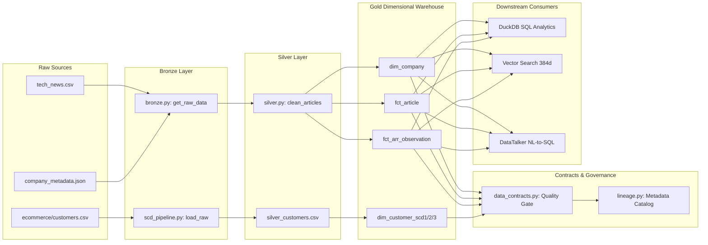

# 🗺️ Part 4: Data Contracts & Lineage Governance — Developer & Engineering Deep-Dive

**Master Orchestrators & Core Modules:**
- **Data Contracts Engine:** `data_contracts.py` (`DataContractValidator`, `validate_all()`)
- **Metadata & Lineage Catalog:** `lineage.py` (`DataLineageCatalog`, `generate_catalog()`)
- **Pipeline Integration:** `pipeline.py` (Invokes quality gate post-Gold materialization)

---

## 📊 End-to-End System Architecture

```
                  [ Medallion Lakehouse Gold Deliverables & SCD Dimensions ]
                     (dim_company, fct_article, fct_arr_observation, dim_customer_*)
                                             │
                                             ▼
┌─────────────────────────────────────────────────────────────────────────────────────────────┐
│                 1. PROGRAMMATIC DATA CONTRACTS ENGINE (data_contracts.py)                   │
│                                                                                             │
│   • Vectorized In-Memory Assertion Suite (Zero Row Iteration)                              │
│     ├── check_unique()      -> Hash-based duplicate scan (Protects Join Cardinality)       │
│     ├── check_not_null()    -> Vectorized null-bitmap scan (Zero-Null Tolerance)            │
│     ├── check_range()       -> SIMD-level boolean mask filtering (Boundary Guard)          │
│     ├── check_foreign_key() -> O(M+N) Hash-Set intersection (Orphan Record Elimination)     │
│     └── check_enum()        -> Categorical taxonomy set-membership guard                    │
└─────────────────────────────────────────────────────────────────────────────────────────────┘
                                             │
                       ┌─────────────────────┴─────────────────────┐
                       │                                           │
          (Pass Rate & Violations)                        (Clean DataFrames)
                       ▼                                           ▼
┌──────────────────────────────────────────────┐ ┌───────────────────────────────────────────┐
│     2. DATA QUALITY SCORECARD & CIRCUIT      │ │    3. AUTOMATED METADATA & LINEAGE        │
│          BREAKER (data_contracts.py)         │ │            CATALOG (lineage.py)           │
│                                              │ │                                           │
│ • Health Score Computation:                  │ │ • In-Memory Schema Profiler:              │
│   Health = (Passed_Rules / Total) * 100      │ │   dtypes, nullability, distinct counts    │
│ • SLA Verification & Circuit Breaker Logic   │ │ • Table-Level Lineage DAG:                │
│ • JSON Audit Report Materialization:         │ │   Raw -> Bronze -> Silver -> Gold         │
│   data/data_quality_report.json              │ │   -> Downstream Consumers                 │
│ • Blocks publication if critical assertions  │ │ • Column-Level Derivation Lineage:        │
│   fail (prevents poisoning serving layer)    │ │   Captures exact mathematical transforms  │
│                                              │ │ • Machine-Readable Catalog Output:        │
│                                              │ │   data/metadata_catalog.json              │
└──────────────────────────────────────────────┘ └───────────────────────────────────────────┘
                       │                                           │
                       └─────────────────────┬─────────────────────┘
                                             │
                                             ▼
┌─────────────────────────────────────────────────────────────────────────────────────────────┐
│                          4. DOWNSTREAM SERVING & ANALYTICAL CONSUMPTION                     │
│                                                                                             │
│ • High-Performance OLAP Analytics: DuckDB SQL Warehouse (04_sql_queries.ipynb)              │
│ • Semantic Vector Search: 384-dimensional dense article embeddings                          │
│ • GenAI Agent Assistants: DataTalker NL-to-SQL (Gemini LLM prompt contextualization)        │
└─────────────────────────────────────────────────────────────────────────────────────────────┘
```

---

## 🏗️ The Data Engineering Paradigm: Why Data Contracts in Lakehouses?

### 1. The Lakehouse Constraint Paradox
In traditional OLTP relational databases (PostgreSQL, MySQL, Oracle), constraints like `PRIMARY KEY`, `FOREIGN KEY`, and `CHECK` are **strictly enforced by the storage engine on write**. If a transaction inserts a duplicate key or an orphan foreign key, the database aborts the transaction with an error.

In modern Lakehouses and OLAP engines (Parquet, Delta Lake, Apache Iceberg, DuckDB, Snowflake, BigQuery):
- Storage and compute are **decoupled**.
- Data is stored in immutable columnar files (Parquet) optimized for parallel reads and high-throughput bulk appends.
- **OLAP engines do NOT enforce foreign keys or unique constraints at write-time** because doing distributed unique checks across billions of records requires massive network shuffle and locks, destroying ingestion throughput.
- In Snowflake, Databricks, and DuckDB, `PRIMARY KEY` and `FOREIGN KEY` declarations are typically **informational metadata hints** for the cost-based query optimizer—they do not reject violating rows!

### 2. The Disaster of Silent Corruption
Without an application-layer contract gate, corrupted data silently enters Gold tables:
1. **Join Fan-Out (Cartesian Explosions)**: If a dimension table primary key contains duplicate keys, every downstream `INNER JOIN` or `LEFT JOIN` duplicates fact records, artificially multiplying revenue, transaction counts, and financial totals.
2. **Orphan Records**: If a foreign key in a fact table points to a non-existent primary key in a dimension table, `INNER JOIN` silently drops the fact record, undercounting revenue.
3. **Out-of-Bounds & Schema Drift**: Negative prices, dates in the year 3000, or mutated category strings cause analytical queries and ML models to fail or produce garbage outputs.

### 3. The "Shift-Left" Data Engineering Solution
Instead of discovering corrupt data days later when a dashboard breaks, Data Engineers implement **Data Contracts** directly within the ETL/ELT pipeline. Data Contracts act as **deterministic quality gates (Circuit Breakers)** that validate data semantics before tables are materialized or published to downstream consumers.

---

## 💻 Developer & Algorithmic Mechanics: `data_contracts.py`

Rather than viewing contract checks as simple column checks, let's analyze how the validation engine is implemented algorithmically from a software engineering and performance perspective.

### 1. Vectorized Memory Scans vs. Python Row Iteration
Iterating over rows with Python `for` loops or `df.iterrows()` in data engineering is an anti-pattern ($O(N)$ with heavy CPython object boxing overhead, taking seconds or minutes on large datasets). 

`DataContractValidator` uses **100% vectorized NumPy/Pandas operations**, executing in compiled C/SIMD instructions with minimal memory allocation:

#### A. `check_not_null(df, column)`
```python
null_count = int(df[column].isnull().sum())
```
- **Engineering Principle**: Operates directly on the column's underlying null bitmask in memory.
- **Complexity**: Time: $O(N)$, Space: $O(1)$ auxiliary memory.
- **DE Purpose**: Guarantees column completeness without copying data.

#### B. `check_unique(df, column)` — Join Cardinality Protection
```python
dup_count = int(df[column].duplicated().sum())
```
- **Engineering Principle**: Leverages a hash-table index over column hashes to detect collisions.
- **Complexity**: Time: $O(N)$ average, Space: $O(K)$ where $K$ is unique keys.
- **DE Purpose**: Protects star-schema join cardinality. Prevents 1-to-many relationship breakage in dimensional modeling.

#### C. `check_range(df, column, min_val, max_val)` — SIMD Boolean Masking
```python
mask = pd.Series([True] * total, index=series.index)
if min_val is not None:
    mask = mask & (series >= min_val)
if max_val is not None:
    mask = mask & (series <= max_val)
violating_count = int((~mask).sum())
```
- **Engineering Principle**: Performs vectorized bitwise `&` over contiguous numeric arrays in memory, avoiding branching logic.
- **Complexity**: Time: $O(N)$, Space: $O(N)$ temporary boolean bitmask.
- **DE Purpose**: Enforces physical boundaries (e.g., $ARR \ge 0$, $0.0 \le discount \le 1.0$, $2000 \le year \le 2030$).

#### D. `check_foreign_key(child_df, child_col, parent_df, parent_col)` — Hash-Set Intersection
```python
parent_keys = set(parent_df[parent_col].dropna())
child_keys = child_df[child_col].dropna()
orphan_mask = ~child_keys.isin(parent_keys)
orphan_count = int(orphan_mask.sum())
```
- **Engineering Principle**: Converts parent primary keys into an in-memory hash set with $O(1)$ average lookup time, then checks child keys via vectorized hash probe.
- **Complexity**:
  - Time: $O(M + N)$ where $M$ is parent row count and $N$ is child row count.
  - Much faster than performing a relational SQL `LEFT JOIN ... WHERE parent.id IS NULL` ($O(M \log N)$ or heavy hash-join overhead).
- **DE Purpose**: Referential integrity verification across lakehouse entities without requiring an RDBMS foreign-key engine.

#### E. `check_enum(df, column, allowed_values)` — Categorical Taxonomy Guard
```python
invalid_mask = ~series.isin(allowed_values)
```
- **Engineering Principle**: Asserts column values against a closed set hash index.
- **Complexity**: Time: $O(N)$, Space: $O(|allowed\_values|)$.
- **DE Purpose**: Prevents categorical fragmentation in downstream `GROUP BY` rollups (e.g. preventing `"silver"` or `"SILVER"` from fracturing the `"Silver"` loyalty tier).

---

### 2. The Quality Scorecard & Circuit Breaker Pattern

In `data_contracts.py`, the master validation loop executes across all warehouse tables and computes unified execution telemetry:

```python
total_rules = len(results)
passed_rules = sum(1 for r in results if r["status"] == "PASS")
failed_rules = total_rules - passed_rules
overall_health_score = round((passed_rules / total_rules * 100), 2)
```

#### Why Output a Structured JSON Report (`data/data_quality_report.json`)?
1. **CI/CD Integration**: In a GitHub Actions or GitLab CI pipeline, a testing step runs `pipeline.py`. If `overall_status == "FAILED"`, the CI step exits with non-zero exit code (`sys.exit(1)`), blocking deployment of bad pipeline code to production.
2. **Orchestrator Gate (Airflow/Prefect)**: Airflow's `ShortCircuitOperator` or `BranchPythonOperator` inspects the scorecard. If health is below 100%, the pipeline diverts to an alerting task (Slack, PagerDuty) and quarantines data rather than publishing to the presentation layer.
3. **Observability Export**: The JSON payload can be scraped by Prometheus, Datadog, or Grafana to track data quality health trends over time.

---

## 🔍 Developer & Algorithmic Mechanics: `lineage.py`

Data lineage is not just documentation—it is a critical data engineering mechanism for **system observability, impact analysis, and root cause analysis (RCA)**.

### 1. In-Memory Schema Profiler & Metadata Crawler
`DataLineageCatalog.generate_catalog()` dynamically crawls each materialized table in memory and extracts structural telemetry:
- **Data Types (`series.dtype`)**: Catches unexpected type coercions (e.g., float columns silently converted to object strings).
- **Nullability Analysis (`series.isnull().sum()`)**: Profiles sparsity across the warehouse.
- **Cardinality Metrics (`series.nunique()`)**: Measures distinct value count, critical for query optimizer indexing and identifying potential primary key candidates.
- **Deterministic Sampling (`series.dropna().head(3)`)**: Captures representative data values for data discovery catalogs without exposing full datasets.

### 2. Coarse-Grained Lineage: Table-Level DAG
`lineage.py` documents the directed acyclic graph (DAG) capturing the transformation trajectory across Medallion layers:
- **Upstream Extraction**: `data/raw/tech_news.csv`, `data/raw/company_metadata.json`
- **Bronze (Immutable Ingestion)**: `bronze.py` (`get_raw_data()`)
- **Silver (Standardization & Cleaning)**: `silver.py` (`clean_articles_pipeline()`)
- **Gold (Star-Schema Dimensional Models)**: `dim_company`, `fct_article`, `fct_arr_observation`, `dim_customer_scd*`
- **Downstream Consumers**: DuckDB OLAP SQL, Dense Vector Embeddings (384-dim), GenAI Text-to-SQL Assistant.



### 3. Fine-Grained Lineage: Column-Level Derivation Rules
Coarse table lineage tells you *where* data came from; **column-level lineage** tells you *how* every output attribute was mathematically created.

In `lineage.py`, column derivations are explicitly tracked:
1. `fct_arr_observation.arr_usd_M`:
   - `REGEX_CURRENCY_EXTRACT` $\rightarrow$ `FX_RATES_TO_USD` (GBP: 1.28, EUR: 1.09, JPY: 0.0067) $\rightarrow$ `MIDPOINT_AVERAGE` $\rightarrow$ `USD_MILLIONS`
2. `dim_company.company_name`:
   - `COMPANY_NAME_MAPPING`: Resolves 46 raw entity spelling variations into 21 canonical enterprise entities.
3. `fct_article.category_clean`:
   - `CATEGORY_MAPPING`: Normalizes 19 disparate raw text tags into 7 standardized industry sectors.
4. `dim_customer_scd2.is_current_flag`:
   - `SCD_TYPE_2_EXPIRATION`: Evaluates `effective_end_date == '9999-12-31'` $\rightarrow$ `True`, else `False`.

---

## 🛠️ The 2 Critical Developer Workflows Enabled by Lineage

### 1. Upstream-to-Downstream Impact Analysis (Blast Radius)
- **Scenario**: The engineering team modifying `data/raw/tech_news.csv` plans to rename `revenue` to `annual_recurring_revenue` or change currency formatting.
- **Developer Workflow**: By querying `metadata_catalog.json` for all dependencies on `tech_news.csv -> revenue`, the developer immediately sees the full blast radius:
  - `clean_articles_pipeline()` in `silver.py` will break.
  - `fct_arr_observation.arr_usd_M` in `gold.py` will fail to calculate.
  - The DuckDB financial analytical views and DataTalker AI prompts will fail.
- **Result**: The team can plan schema migrations proactively before deploying breaking changes.

### 2. Downstream-to-Upstream Root Cause Analysis (RCA)
- **Scenario**: An executive notices that an analytical ARR chart in DuckDB reports unusually high revenue for an enterprise company in Q3.
- **Developer Workflow**: Instead of guessing where the bug is, the engineer consults the column lineage:
  1. Identifies the output column: `fct_arr_observation.arr_usd_M`.
  2. Inspects derivation formula: checks if FX normalization, currency regex, or company alias mapping caused the inflation.
  3. Traces backward to the exact row in `data/raw/tech_news.csv` using `article_id` to verify if the raw article itself reported the number or if the FX parser miscalculated.
- **Result**: Resolution time drops from hours of code-diving to minutes of systematic root-cause tracing.

---

## 🔄 Industry Framework Mapping: How This Compares to Enterprise Tools

In production enterprise data stacks, Data Engineers use specialized frameworks to implement these exact concepts. The table below maps our custom Python modules to industry standards:

| Capability | This Project (`part4`) | dbt (Data Build Tool) | Great Expectations / SodaCL | OpenLineage / Marquez |
| :--- | :--- | :--- | :--- | :--- |
| **Not Null Check** | `check_not_null()` | `tests: - not_null` | `expect_column_values_to_not_be_null` | Metric assertions in facets |
| **Primary Key Uniqueness** | `check_unique()` | `tests: - unique` | `expect_column_values_to_be_unique` | Cardinality assertion |
| **Referential Integrity (FK)** | `check_foreign_key()` | `tests: - relationships` | `expect_column_values_to_be_in_set` | Graph relationship assertions |
| **Range & Math Bounds** | `check_range()` | Custom dbt expressions / dbt-expectations | `expect_column_values_to_be_between` | Schema/Range metrics |
| **Categorical Set Checks** | `check_enum()` | `tests: - accepted_values` | `expect_column_values_to_be_in_set` | Taxonomy validation |
| **Quality Scorecard** | `data_quality_report.json` | `target/run_results.json` | Data Docs HTML / JSON summary | Run facets & validation outputs |
| **Table Lineage Graph** | `table_lineage_graph` | `dbt docs generate` (DAG view) | Resource catalog integration | OpenLineage Input/Output Datasets |
| **Column-Level Lineage** | `column_lineage_rules` | Semantic layer / Column lineage (Cloud) | Soda column profiling | Marquez Column-Level Lineage (CLL) |
| **Catalog Metadata Export** | `metadata_catalog.json` | `target/manifest.json` | Great Expectations Metadata Store | OpenLineage events to Marquez/DataHub |

### Why Write This in Pure Python?
1. **Zero External Overhead**: Enterprise tools like Great Expectations or Soda require significant configuration, third-party YAML setups, and heavy dependencies.
2. **Sub-Second Execution**: Vectorized in-memory Pandas/NumPy execution takes **~0.05 seconds**, making it ideal for micro-batch ETL pipelines, DuckDB workloads, and local testing.
3. **Deep Educational Value**: Understanding the underlying hash-table operations, bitmasks, and set intersections teaches you what tools like dbt and Great Expectations are actually doing under the hood!

---

## 🚀 Execution & Verification in the Master Pipeline

To execute and verify both engines in the project:

### 1. Run via Master Orchestrator (`pipeline.py`)
```bash
# Run full lakehouse pipeline including data contract evaluation and lineage catalog export
python pipeline.py --lineage
```

### 2. Inspect the Generated Developer Artifacts
- **Quality Scorecard**: Open `data/data_quality_report.json` to inspect:
  - Evaluation timestamp, wall-clock duration (`duration_seconds`).
  - Total rules evaluated, passed count, failed count, overall health percentage.
  - Per-rule diagnosis with row counts and exact pass rate percentages.
- **Lineage Catalog**: Open `data/metadata_catalog.json` to inspect:
  - `catalog_metadata`: Platform description and active governance standards.
  - `table_lineage_graph`: Multi-domain sources, Bronze, Silver, Gold, and consumer mappings.
  - `column_lineage_rules`: Field-level transformation formulas and business logic.
  - `tables`: Introspected table schemas, dtypes, null counts, distinct cardinality, and sample rows.
